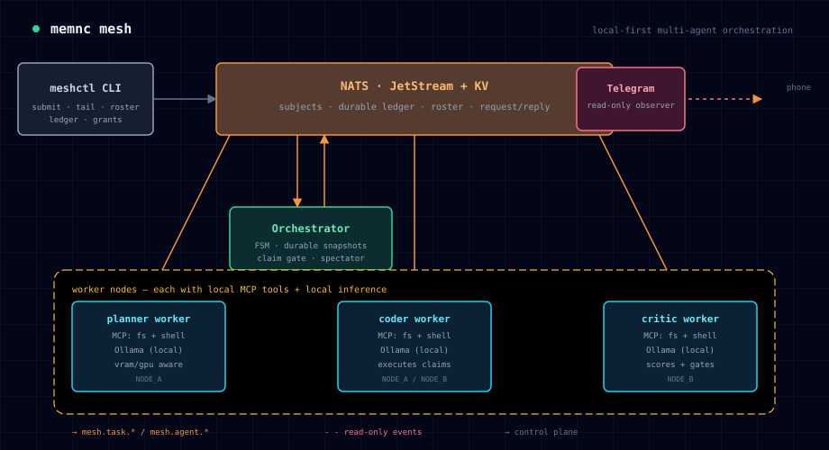

# memnc

[](LICENSE)
[](pyproject.toml)
[](#security-model)

**A multi-agent mesh that runs entirely on your own hardware.**
NATS is the only backbone. A durable state machine drives `planner → coder → critic`
across worker nodes. Every worker runs a local MCP tool server (filesystem + shell)
and talks to its own local inference endpoint (Ollama or any OpenAI-compatible API).
Claimable tasks run **worker-driven**: the claiming worker advances the pipeline
itself via CAS role-gated handoffs — the orchestrator is a spectator you can kill
mid-run without stopping the pipeline.

No agent framework. No cloud dependencies. No model-serving code.

<p align="center">
  
</p>

## Why

- **Your GPUs, your models, your data** — nothing leaves the network.
- **The mesh is the memory** — every stage is attributed in a durable ledger
  (`meshctl ledger`), not in an agent's chat history.
- **Resource-aware claiming** — workers advertise VRAM, GPU and on-disk models;
  the claim gate routes tasks to nodes that can actually run them.
- **Human in the loop, on your phone** — a Telegram observer streams task events
  and takes gated control commands (`/submit`, `/cancel`, `/retry`, `/stop worker`);
  the model pull path is approval-gated.

## Quick start

```bash
cp .env.example .env        # set INFERENCE_BASE_URL and MODEL_*
mkdir -p workspace          # bind-mounted at /workspace in every container
docker compose up --build -d

python3 -m venv .venv
.venv/bin/pip install -e ".[dev]"

export NATS_URL=nats://127.0.0.1:4222 NATS_TOKEN=dev-token
.venv/bin/meshctl doctor

TASK_ID=$(.venv/bin/meshctl submit "Create hello.py that prints hello from the mesh")
.venv/bin/meshctl tail "$TASK_ID"
```

More capacity is one flag: `docker compose up -d --scale worker-coder=3`.
Two-machine mesh, worker-driven claimable tasks and grant/revoke semantics are
covered in [`docs/plan.md`](docs/plan.md).

## What's live

| Feature | Status |
|---|---|
| Worker-driven pipeline (CAS claim, role gate) | ✅ shipped |
| Cross-node claiming + grants (gateway, sticky revoke) | ✅ shipped |
| Resource-aware claim gate (VRAM / GPU / roles) | ✅ shipped |
| Telegram observer + gated control commands | ✅ shipped |
| Web task console (roster, task detail, cancel/retry) | ✅ shipped |
| Debate trace: coder/critic revisions in `/trace` | ✅ shipped |
| Model lifecycle: pull whitelist, reputation, retirement gate | ✅ shipped |
| Model routing visible (`/trace` shows node:model per role) | ✅ shipped |
| Roster advertises `disk_models` (Ollama `/api/tags`) | ✅ shipped |
| Experience graph: observation deposits + trace query (§14.13 steps 0–2) | 🚧 in progress |
| Role-specific LoRA adapters + Fisher-Merge (§19.1 B2/B4) | 🚧 planned |
| Leader synthesis layer, MLPO pattern (§19.1 B3) | 🚧 planned |
| Orchestrator model-demand planning → approval gate | 🚧 in progress |
| Console v2: live view + problem surface (§14.10) | 🚧 planned |
| Robustness: worker crash, timeout/requeue, orchestrator restart | 🚧 planned |
| LAN model blob sharing between nodes | 🚧 planned |

Design details and staged plan: [`docs/roadmap.md`](docs/roadmap.md) — Part I is
the epic/task plan with its table of contents, Part II the chronological log.
Research-informed build order (26-paper corpus → build/prototype/observe triage,
brownfield status): [`docs/plan.md`](docs/plan.md) §19.

## Documentation

| Document | Contents |
|---|---|
| [`docs/plan.md`](docs/plan.md) | The specification: architecture, wire protocol, orchestrator, workers, deployment, security |
| [`docs/roadmap.md`](docs/roadmap.md) | One document: Part I the plan (ten epics E1–E10, tasks with status), Part II the chronological log (§14–§19) |

New documentation is consolidated into these files, not added as new files.

## Configuration

Everything is environment-driven; see [`.env.example`](.env.example) for the full list.

| Variable | Default | Purpose |
|---|---|---|
| `NATS_URL` | `nats://127.0.0.1:4222` | NATS server |
| `NATS_CONF` | — | NKey mode, recommended: the file `scripts/gen_nkeys.py` writes into `secrets/` |
| `NATS_TOKEN` | — | token mode; scheduled for removal (roadmap T11.12) |
| `ALLOW_SHELL` | `true` | shell tool on worker nodes; `false` disables command execution |
| `MESH_CLAIM` | `false` | claim model: workers claim claimable tasks; off = orchestrator dispatch |
| `SELF_PIPELINE` | `true` | with `MESH_CLAIM`: the claiming worker runs the whole pipeline |
| `TELEGRAM_ALLOW` / `TELEGRAM_ALLOW_USERS` | — | chats that may read / numeric user ids that may write; empty user list = read-only |
| `CONSOLE_HOST` | `127.0.0.1` | console bind address; a non-loopback value has no authentication |
| `INFERENCE_PROVIDER` | `ollama` | `ollama` (native) or `openai` (compatible) |
| `INFERENCE_BASE_URL` | — | endpoint root, per-node |
| `MODEL_PLANNER` / `MODEL_CODER` / `MODEL_CRITIC` | — | per-role model names |
| `NODE_VRAM_GB` / `NODE_GPU` | `0` / — | advertised in the roster, used by the claim gate |
| `MESH_GATE` | `false` | registry gate; `MESH_GRANT_NODES` bootstraps grants |
| `MAX_REVISIONS` | `3` | critic rejection cycles before failing |
| `MODEL_PULL_WHITELIST` | `[]` (closed) | fnmatch patterns for the approval-gated model pull path; empty list closes it |

Models with native tool calling work best. Without tools the worker still works:
the coder returns file contents as JSON and the orchestrator applies them.

## Security model

Every node is zero trust: it authenticates with its own NKey, and no payload field is
trusted on its own. The trust tiers and the open security items are in
[`docs/plan.md`](docs/plan.md) §21 and [`docs/roadmap.md`](docs/roadmap.md) E11.

The shell tool runs with the worker's permissions and is on by default (`ALLOW_SHELL`).
In the default container the boundary is: non-root user, `cap_drop: ALL`,
`no-new-privileges`, read-only root filesystem, CPU/memory/PID limits, only the workspace
bind mount writable, no Docker socket. A node that runs without the container has no
sandbox. Sandboxing is optional and set per node. Set `ALLOW_SHELL=false` to disable
command execution. Inbound message content (Telegram, NATS) is treated as untrusted data,
never instructions. Secrets live in the gitignored `.env` and never appear in payloads or
logs.

## Local development

```bash
docker run -d --rm -p 127.0.0.1:4222:4222 nats:2-alpine -js   # loopback only, no auth: local development
python3 -m venv .venv && .venv/bin/pip install -e ".[dev]"
.venv/bin/python -m pytest            # unit tests, no NATS required
./scripts/e2e.sh                      # full end-to-end against a running mesh
```

## Layout

```
src/memnc/
  schema.py        # envelope + payload contract
  fsm.py           # pure state machine
  bus.py           # NATS stream, KV snapshots, consumers
  orchestrator.py  # FSM runtime, recovery, timeout reaper
  worker.py        # pull loop, agent loop, checkpoints
  agent.py         # tool loop + JSON parsing
  backends/        # ollama + openai-compatible clients
  mcp/             # stdio tool server/client (fs + shell)
  cli.py           # meshctl
  telegram.py      # Telegram observer + control commands
  console.py       # web task console
docs/              # architecture, protocol, operations
```

## Contributing & License

See [CONTRIBUTING.md](CONTRIBUTING.md). Apache License 2.0 — see
[LICENSE](LICENSE). Copyright in each contribution belongs to its commit
author, recorded automatically in git history; there are no per-file headers.
